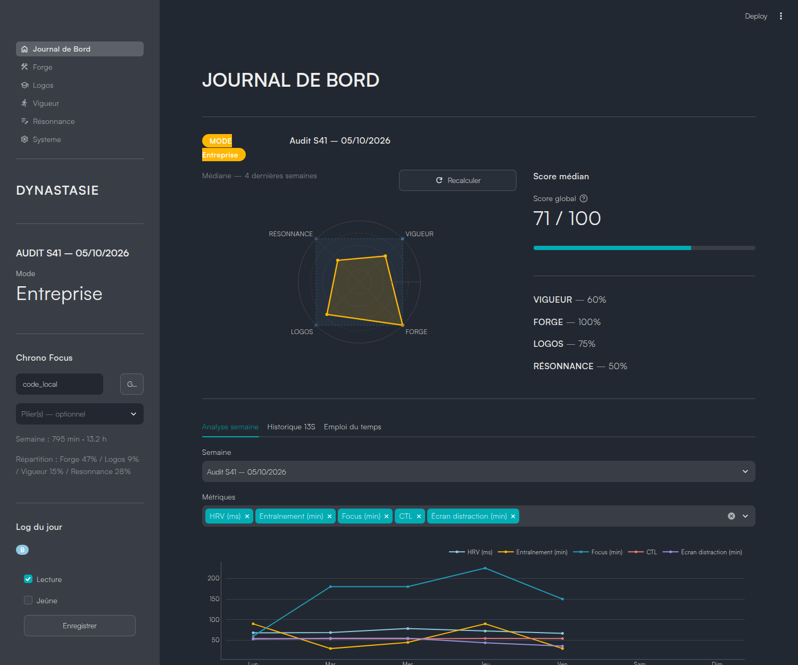

# DynaStasis

**Un tableau de bord hebdomadaire personnel, local et sans compte.** Il rassemble sport, focus, habitudes, temps d'écran, finances, objectifs et projets dans une base SQLite, et en tire un score hebdomadaire configurable.

Streamlit + SQLite, tout reste sur votre machine. Chaque source de données (Intervals.icu, Strava, ADB, exports bancaires) est **facultative** : on peut tout saisir à la main.



> Captures générées à partir de la base de démonstration : toutes les données sont fictives.

---

## Démarrage rapide (moins de 10 minutes)

Aucune clé, aucun compte : la commande `seed-demo` fabrique une base de démonstration.

### Avec Docker

```bash
git clone https://github.com/Zapadmor/DynaStasis.git
cd DynaStasis
docker compose -f docker-compose.demo.yml up --build
```

Ouvrez <http://localhost:8502>. La base de démo est créée au démarrage et jetée avec le conteneur.

### Image publiée (sans cloner)

Les images sont publiées sur GitHub Container Registry (`latest` suit `main`, les versions portent le tag `vX.Y.Z`, la variante avec `adb` le suffixe `-adb`) :

```bash
docker run --rm -p 8502:8501 -e DYNASTASIS_DB=/tmp/demo/dynastasie-demo.db \
  ghcr.io/zapadmor/dynastasis-app:latest \
  sh -c "python main.py seed-demo && streamlit run src/app/ui_main.py --server.headless true"
```

### En local (Python 3.12)

```bash
git clone https://github.com/Zapadmor/DynaStasis.git
cd DynaStasis
python3 -m venv env && source env/bin/activate
pip install -r requirements.txt
python main.py seed-demo          # crée data/demo/dynastasie-demo.db
DYNASTASIS_DB=data/demo/dynastasie-demo.db python main.py app
```

Ouvrez <http://localhost:8501>. `seed-demo` peut être relancé à volonté : il recrée la base de démo, sans jamais toucher à une base réelle (voir [installation](docs/installation.md)).

---

## Utiliser vos propres données

```bash
python main.py init-db            # crée db/dynastasie.db (base vide)
python main.py app                # l'interface fonctionne sans aucune source
```

1. **Saisie manuelle** : habitudes et chrono focus dans la barre latérale, audit hebdomadaire (page Résonnance), objectifs et projets (page Forge), temps d'écran (`python main.py logos --manual`).
2. **Personnalisation** : `cp config/user.toml.example config/user.toml` (fuseau horaire, seuils et poids du score, libellés des modes, piliers actifs) — voir [configuration](docs/configuration.md).
3. **Sources automatiques** (au choix) : copiez `secrets.env.example` vers `~/.config/dynastasie/secrets.env`.

| Source | Ce qu'elle apporte | Secrets (`secrets.env`) | Obtenir la clé |
|---|---|---|---|
| Intervals.icu | charge (CTL/ATL/TSB), HRV, sommeil, pas, activités | `INTERVALS_ICU_ATHLETE_ID`, `INTERVALS_ICU_API_KEY` | [Réglages → Developer Settings](https://intervals.icu/settings) |
| Strava | records personnels | `STRAVA_CLIENT_ID`, `STRAVA_CLIENT_SECRET` (puis `python main.py strava-auth`) | [Créer une application API](https://www.strava.com/settings/api) |
| Téléphone Android (ADB) | temps d'écran par application | `SAMSUNG_ADB_HOST`, `SAMSUNG_ADB_PORT` | [Débogage sans fil Android](https://developer.android.com/tools/adb#connect-to-a-device-over-wi-fi) |
| Calendrier Google | emploi du temps intégré | `CALENDAR_SRC` | Google Agenda → Paramètres → *Intégrer l'agenda* |
| Exports bancaires | patrimoine, transactions, budget | aucun (fichiers dans `data/inbox/`) | exports CSV/XLSX de votre banque |

Le détail est dans [docs/configuration.md](docs/configuration.md).

---

## Commandes

| Commande | Effet |
|---|---|
| `python main.py app` | lance l'interface (défaut) |
| `python main.py seed-demo [--db chemin]` | crée la base de démonstration |
| `python main.py init-db` | crée / migre la base |
| `python main.py sync [--only a,b] [--timeout N]` | synchronise chaque source configurée (Intervals.icu, Strava, ADB, finance), isolées ; code de retour 1 si l'une échoue |
| `python main.py vigueur [--full --lookback N] [--only intervals\|strava]` | synchronise Intervals.icu et Strava |
| `python main.py logos [--manual]` | temps d'écran (ADB ou saisie manuelle) |
| `python main.py finance` | résumé financier depuis `data/inbox/` |
| `python main.py strava-auth` | autorisation OAuth Strava |
| `python main.py profile export\|import fichier.json` | sauvegarde / restauration du contenu de profil |

Variables utiles : `DYNASTASIS_DB` (chemin de la base), `DYNASTASIS_CONFIG` (chemin de `user.toml`), `DYNASTASIS_ENV_FILE` (chemin de `secrets.env`).

---

## Documentation

- [Installation](docs/installation.md) — Docker, local, mise à jour, synchronisation planifiée
- [Configuration](docs/configuration.md) — `secrets.env`, `user.toml`, contenu de profil
- [Les piliers](docs/piliers.md) — ce que mesure chaque page et comment le score est calculé
- [Architecture](docs/architecture.md) — schéma de données, flux, migrations
- [FAQ](docs/faq.md)
- [Contribuer](CONTRIBUTING.md) · [Journal des changements](CHANGELOG.md)

## Licence

Voir [LICENSE](LICENSE).
